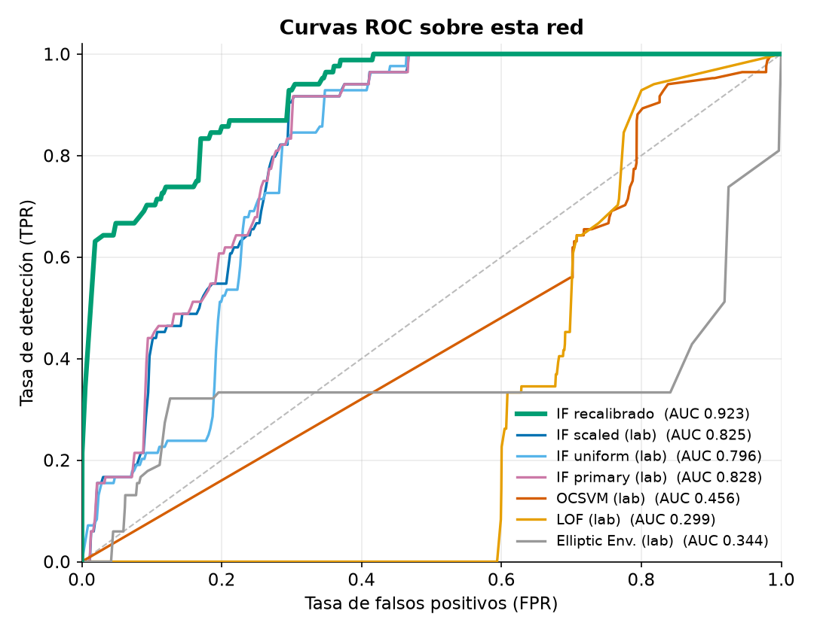
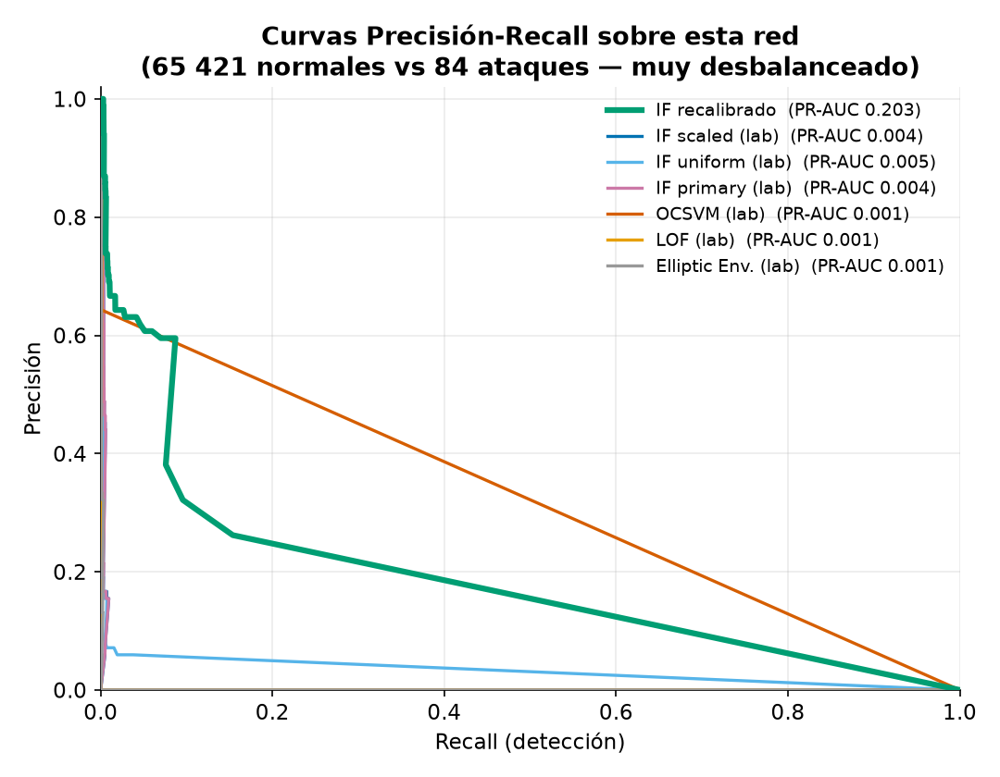
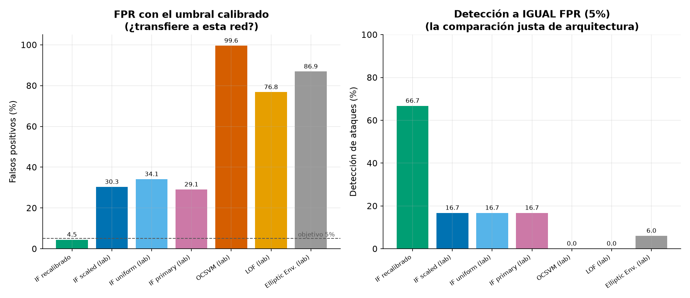
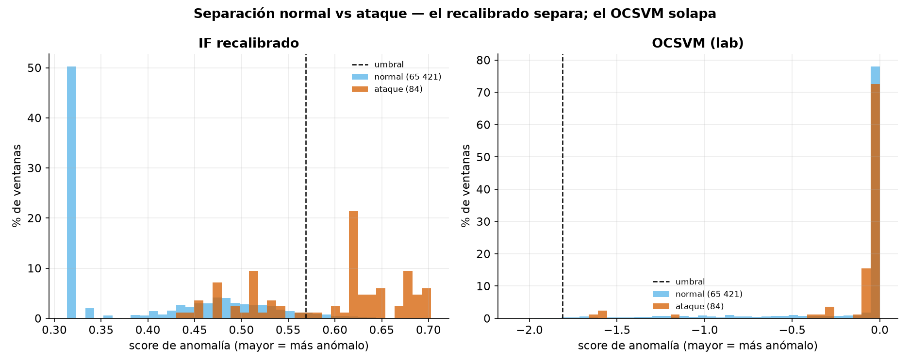

# Comparación de modelos sobre ESTA red — benchmark completo

**Fecha:** 14-oct-2026 · **Pregunta:** de los 7 detectores candidatos, ¿cuál es
el mejor **en la red donde opera** el sistema? (En el laboratorio ganó el OCSVM;
aquí no.)

## Datos y protocolo

- **Negativos (normal):** 65 421 ventanas del **conjunto de oro** (partición de
  prueba de la calibración, nota L), tráfico legítimo de esta red.
- **Positivos (ataque):** 84 ventanas de ataque de la Kali (nota M).
- Cada modelo se carga de su `joblib` congelado y se le pasa `score_samples`
  sobre los mismos datos. No se reentrena nada.
- **Muy desbalanceado** (prevalencia de ataque 0,13 %): por eso el titular NO es
  la precisión ni el F1 (que son bajos para todos por construcción), sino las
  métricas robustas al desbalance: **ROC-AUC, PR-AUC, FPR y detección a igual FPR**.

## Dos preguntas, dos comparaciones

1. **¿Transfiere a esta red?** Cada modelo con **su umbral calibrado** (el de su
   origen). Mide si el modelo de laboratorio sirve aquí tal cual.
2. **¿Qué arquitectura es mejor aquí?** Cada modelo recalibrado al **mismo FPR
   (5 %)** sobre esta red, y se compara la **detección**. Aísla la arquitectura
   de la ventaja del umbral.

---

## Tabla completa

| Modelo | ROC-AUC | PR-AUC | FPR (umbral calibrado) | Recall | F1 | MCC | Exactitud balanc. | **Detección @ FPR 5 %** |
|---|---:|---:|---:|---:|---:|---:|---:|---:|
| **IF recalibrado (desplegado)** | **0,923** | **0,203** | **4,45 %** | 64,3 % | 0,035 | **0,103** | 0,799 | **66,7 %** |
| IF scaled (lab) | 0,825 | 0,004 | 30,34 % | 91,7 % | 0,008 | 0,048 | 0,807 | 16,7 % |
| IF primary (lab) | 0,828 | 0,004 | 29,07 % | 82,1 % | 0,007 | 0,042 | 0,765 | 16,7 % |
| IF uniform (lab) | 0,796 | 0,005 | 34,13 % | 85,7 % | 0,006 | 0,039 | 0,758 | 16,7 % |
| OCSVM (lab) — *ganó en el laboratorio* | 0,456 | 0,001 | 99,57 % | 100 % | 0,003 | 0,002 | 0,502 | 0,0 % |
| LOF (lab) | 0,299 | 0,001 | 76,80 % | 70,2 % | 0,002 | −0,006 | 0,467 | 0,0 % |
| Elliptic Envelope (lab) | 0,344 | 0,001 | 86,90 % | 42,9 % | 0,001 | −0,047 | 0,280 | 6,0 % |

Matriz de confusión (umbral calibrado):
- **IF recalibrado:** TN 62 508 · FP 2 913 · FN 30 · **TP 54** → FPR 4,45 % (IC95 [4,30 – 4,61]), recall 64,3 % (IC95 [53,6 – 73,7]).
- **OCSVM:** TN 280 · **FP 65 141** · FN 0 · TP 84 → "detecta todo" solo porque marca el 99,57 % del tráfico normal.

---

## Gráficos

**Curvas ROC.** El IF recalibrado domina (AUC 0,923). El OCSVM queda **por
debajo de la diagonal** (AUC 0,456): en esta red su score ni siquiera ordena
bien ataque frente a normal.

**Curvas Precisión-Recall** (más informativas con este desbalance). El IF
recalibrado tiene PR-AUC 0,203 frente a ~0,004 del resto — unas **50 veces** mejor.

**Lo operativo: FPR y detección a igual FPR.** Izquierda: con su umbral, solo el
IF recalibrado cae bajo el objetivo de 5 % de FPR. Derecha: a **igualdad de FPR
(5 %)**, el IF recalibrado detecta **66,7 %**, el mejor de laboratorio 16,7 %, y
el OCSVM/LOF **0 %**.

**Por qué.** El IF recalibrado **separa** las ventanas normales (score bajo) de
las de ataque (score alto); el OCSVM las **solapa** todas en el mismo valor, así
que ningún umbral las distingue aquí.

---

## Significancia (McNemar + corrección de Holm)

Comparando los aciertos/errores del IF recalibrado contra cada candidato (a FPR
5 %):

- **vs OCSVM** y **vs LOF:** p_holm < 0,001 → la diferencia es **significativa**.
- vs los IF de laboratorio: p_holm = 1,0 al nivel de predicción a 5 % de FPR
  (hacen pocas predicciones positivas), pero la ventaja del IF recalibrado es
  clara e inequívoca en **ROC-AUC y PR-AUC** (0,923 / 0,203 vs 0,80-0,83 / ~0,004).

---

## Conclusión

Sobre la red donde de verdad opera el sistema, **el Isolation Forest recalibrado
gana en todas las métricas que importan**:

- Mejor **ROC-AUC** (0,923) y **PR-AUC** (0,203), con diferencia.
- Único con un **FPR usable** (4,45 %) con su umbral.
- A **igualdad de FPR**, la **mejor detección** (66,7 % vs ≤16,7 %).

No es solo el umbral: al **entrenarse con el tráfico normal de esta red**, aprende
qué es normal **aquí** y separa los ataques mucho mejor. El ganador del
laboratorio (OCSVM) directamente **no transfiere**: en esta red no distingue
ataque de tráfico normal (ROC-AUC 0,456). Esto justifica empíricamente la
decisión de desplegar el IF recalibrado y no el ganador de laboratorio.

> **Nota sobre precisión/F1.** Son bajos para TODOS por el desbalance extremo
> (84 ataques entre 65 505 ventanas): un FPR del 4,45 % ya genera miles de FP
> frente a decenas de TP. En operación eso no se traduce en bloqueos: una
> anomalía del modelo da **LIMIT** (reversible), el bloqueo lo deciden los
> heurísticos de alta confianza, y hay revisión humana. Por eso la métrica
> honesta aquí es FPR + detección, no la precisión.
