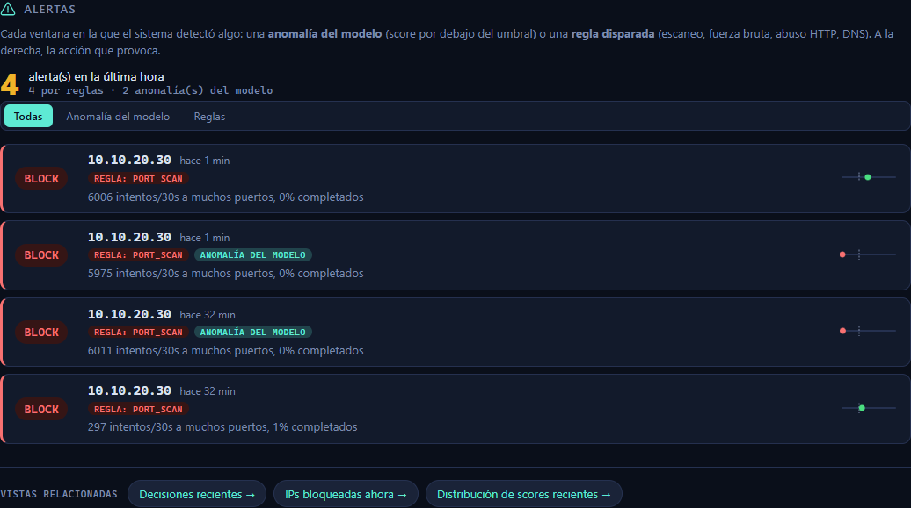
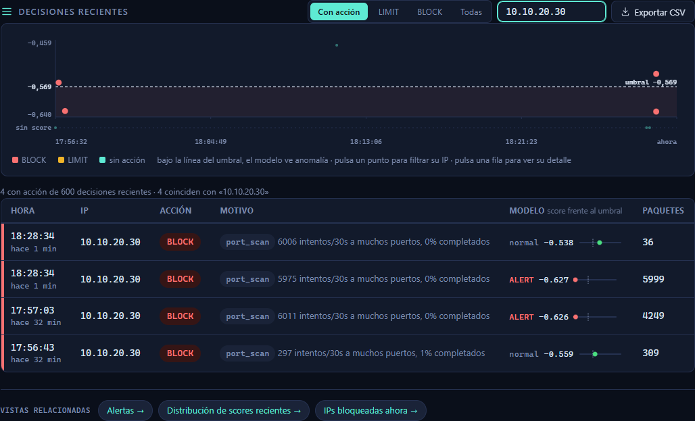
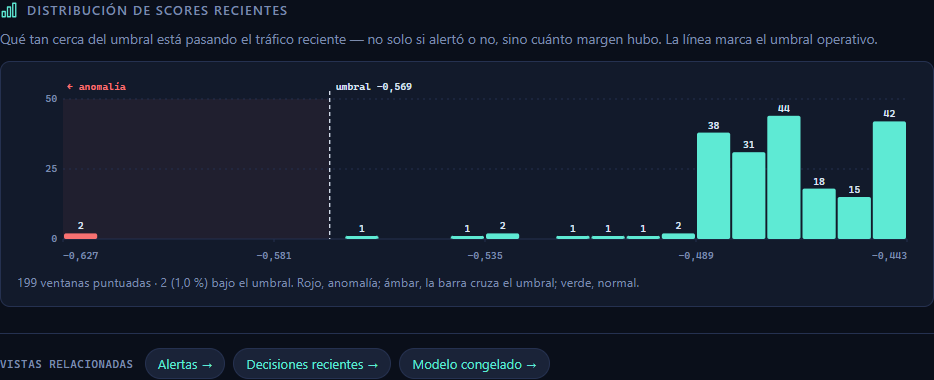
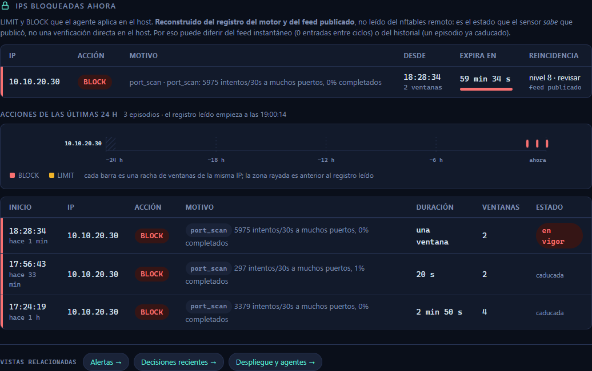
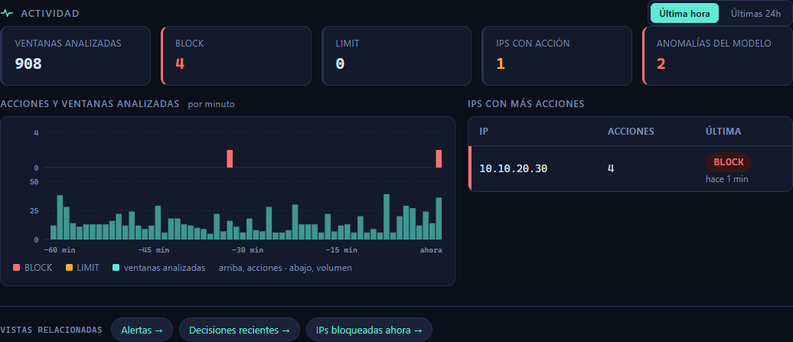
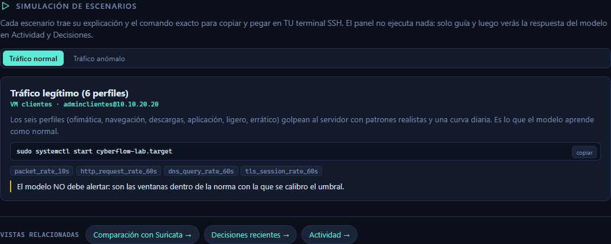
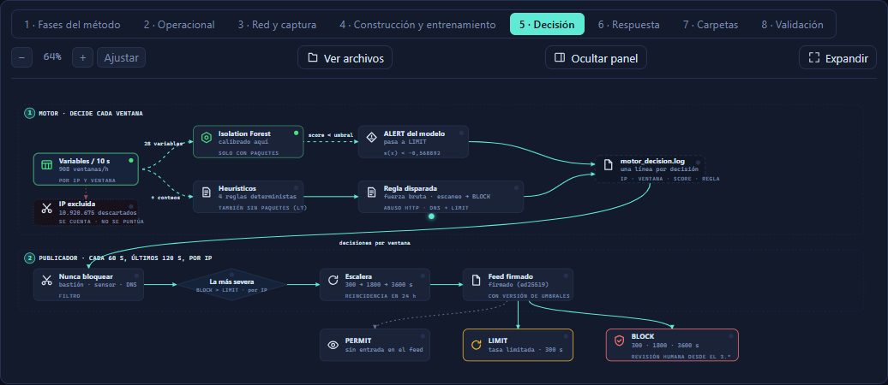

# Recorrido completo: ataque → detección → respuesta → visualización

**Fecha:** 13-oct-2026 · **Escenario:** *Escaneo de puertos* (sección Simulación del panel)
**Ataque desde:** Kali `10.10.20.30` · **Objetivo:** srv-dmz `10.10.30.10`
**Detecta/decide:** Sensor `10.10.60.11` · **Aplica el bloqueo:** agente en srv-dmz (nftables)

Este documento sigue un ataque real de principio a fin: lo que se ejecuta en la
Kali, lo que hace el motor, cómo se propaga la respuesta hasta el host, y **dónde
se ve cada cosa en el panel**. Al final, cómo validar que lo ejecutado coincide
con lo visualizado.

> **Capturas actualizadas (panel revisado).** Las imágenes son del panel tras una
> pasada de precisión: «Alertas reales» → «Anomalías del modelo» (no equivalen a
> ataques confirmados), «Aprendizaje supervisado» → «Reentrenamiento con aprobación
> humana», y Bloqueos declara que su estado es **reconstruido del registro y del
> feed**, no leído del nftables remoto del host.

---

## 0. Componentes activos (antes de empezar)

| Componente | Host | Estado |
|---|---|---|
| Sensor · motor / captura / Suricata / panel / publicador | cyberflow-sensor 10.10.60.11 | activos |
| Relay del feed | VM-GESTION 10.10.10.30 | `ppi-relay-feed.timer` activo |
| Agente + cortafuegos | srv-dmz 10.10.30.10 | `ppi-enforce-agent.timer` activo |
| Atacante | Kali 10.10.20.30 | encendida, SSH OK |

> **Nota de red:** en este laboratorio el cortafuegos de segmentación deja a la
> Kali solo HTTPS (443) hacia la DMZ; el puerto 80 está *filtered* e ICMP
> bloqueado. Por eso los ataques HTTP en claro (nikto, flood sobre el 80) no
> llegan, y sobre HTTPS Suricata solo ve TLS cifrado (no dispara las reglas de
> aplicación). El **escaneo de puertos sí** se valida de extremo a extremo
> porque opera a nivel TCP/flujo, que el sensor observa por el espejo SPAN.

---

## 1. El ataque (desde la Kali)

Comando ejecutado en la Kali (el que propone la sección Simulación, acotado a
3000 puertos para abreviar; el patrón de detección es el mismo con `-p-`):

```
nmap -sT -T4 --max-retries 1 -p 1-3000 --open 10.10.30.10
```

Salida (22:56:57 UTC):

```
Nmap scan report for 10.10.30.10
Host is up (0.00071s latency).
Not shown: 2999 filtered tcp ports (no-response)
PORT    STATE SERVICE
443/tcp open  https
Nmap done: 1 IP address (1 host up) scanned in 22.01 seconds
```

El escaneo genera ~3000 intentos de flujo a muchos puertos en pocos segundos.

---

## 2. Qué hace el motor (detección)

El sensor ve una copia del tráfico por el espejo SPAN. El motor ventanea por IP
cada 10 s y, sobre las variables de la ventana, decide. Línea real del registro
(`logs/motor_decision.log`):

```json
{"decision": "ALERT", "detector_name": "if_recalibrado_2026_09",
 "entity_ip": "10.10.20.30",
 "heuristico": {"accion": "BLOCK", "heuristico": "port_scan",
                "motivo": "6011 intentos/30s a muchos puertos, 0% completados"},
 "score": -0.62..., "threshold": -0.568892,
 "window_end_utc": "2026-10-13T22:57:..."}
```

Dos señales a la vez:

- **Regla determinista `port_scan` → BLOCK:** *"6011 intentos/30s a muchos
  puertos, 0% completados"*. El patrón de escaneo es inequívoco.
- **Anomalía del modelo (IsolationForest recalibrado):** `score −0,62 < umbral
  −0,568892` → la ventana cae en la zona de anomalía. El modelo, por su cuenta,
  también la marca.

La acción final por IP es la **más severa**: **BLOCK**.

---

## 3. La cadena de respuesta (sensor → host)

El sensor **decide pero no ejecuta** (solo observa por espejo). La acción viaja
firmada y la aplica el host:

```
decisión (motor)  →  feed firmado ed25519 (cada 60 s)
                  →  relay en el bastión (cada 60 s)
                  →  agente en srv-dmz (pull cada 60 s, verifica la firma)
                  →  nftables en srv-dmz
```

Elemento aplicado en nftables de srv-dmz (observado ~2–3 min tras la detección,
dentro de los tres ciclos de 60 s):

```
set cyberflow_bloqueados { elements = { 10.10.20.30 timeout ... } }
```

**Prueba de enforcement** (desde la Kali):

| Momento | `nmap -p443 10.10.30.10` |
|---|---|
| Antes del ataque | `443/tcp open` |
| Después del BLOCK | `443/tcp filtered` ← la Kali queda cortada del servidor |

El bloqueo **caduca solo** por el timeout del set (escalera por reincidencia:
300 → 1800 → 3600 s …). No hay bloqueo permanente automático.

---

## 4. La visualización en el panel

### 4.1 Alertas — *lo que el sistema detectó*

Lista cada ventana que provocó una acción, con su tipo (regla y/o anomalía del
modelo), el motivo y la mini-barra de score frente al umbral.



Se ven las ventanas BLOCK de la Kali: **REGLA: PORT_SCAN** en todas, y
**ANOMALÍA DEL MODELO** en las que el score bajó del umbral. El resumen cuenta
las de la última hora por tipo (*por reglas* · *anomalías del modelo*). El KPI de
Salud que antes se llamaba «Alertas reales» pasó a **«Anomalías del modelo»**,
porque una anomalía del modelo no equivale a un ataque confirmado.

### 4.2 Decisiones — *el registro por ventana*

Filtrado por `10.10.20.30`: cada ventana con su acción, el score frente al
umbral (mini-barra) y el motivo. Exportable a CSV.



### 4.3 Scores — *la mirada del modelo*

El histograma de scores recientes. La ventana del ataque es la **barra roja a la
izquierda del umbral** (`1 (0,4 %) bajo el umbral`, marcada «← anomalía»). El
resto del tráfico, verde (normal).



### 4.4 Bloqueos — *la respuesta efectiva*

La Kali aparece **BLOCK en vigor** con su motivo (`port_scan: … intentos/30s`),
desde cuándo, cuánto le queda y el nivel de reincidencia. Debajo, el historial de
24 h con los episodios (uno «en vigor», los anteriores «caducada»).

> **Fuente del estado (importante para no confundir cifras):** esta vista está
> **reconstruida del registro del motor y del feed publicado**, no leída del
> nftables remoto del host. Es lo que el sensor *sabe* que publicó, no una
> verificación directa en srv-dmz. Por eso puede diferir del feed instantáneo
> (0 entradas entre ciclos) o del historial (un episodio ya caducado). La vista
> ahora lo declara explícitamente.



### 4.5 Actividad y Simulación

Actividad muestra el pico de BLOCK en la línea de tiempo; Simulación explica el
escenario, da el comando exacto y describe la respuesta esperada.




### 4.6 Mapa del sistema (vista Decisión)

El flujo de la decisión: variables → modelo / heurísticos → la más severa por IP
→ escalera → feed → PERMIT/LIMIT/BLOCK.



---

## 5. Cómo validar que lo ejecutado coincide con lo visualizado

| Lo que hice en la Kali | Lo que hace el motor | Dónde se ve en el panel |
|---|---|---|
| `nmap` ~3000 puertos a srv-dmz | detecta `port_scan` (~6000 intentos/30s) + score por debajo del umbral | **Alertas** (REGLA: PORT_SCAN + ANOMALÍA), **Decisiones** (fila BLOCK), **Scores** (barra roja) |
| — | acción más severa = BLOCK, con escalera y lista nunca-bloquear | **Decisiones** (acción), **Mapa → Decisión** |
| — | publica el feed firmado, el agente lo aplica | **Bloqueos** (en vigor, «feed publicado»), **Despliegue** (cadena) |
| `nmap -p443` tras el bloqueo → `filtered` | el host dropea a la Kali | **Bloqueos** (BLOCK vigente con caducidad) |

Criterio de validación: **la IP, la hora, el motivo y el score del panel
coinciden con la línea del `motor_decision.log`**, y el `timeout` del elemento
nftables en srv-dmz coincide con la caducidad que muestra Bloqueos.

---

## 6. Protección de la línea base

Antes de atacar se añadió la ventana del ensayo a `excluir_ventanas` del
`cyberflow.local.toml` (con copia de seguridad y validación del TOML), para que
el tráfico de ataque **no entre al entrenamiento**. Además, el propio aprendizaje
excluye las IP que el motor marcó como sospechosas durante esas ventanas.

---

## 7. Qué se añadió y corrigió a raíz de esta validación

**Añadido**

- **Vista «Alertas»** (nueva, en Vigilancia): faltaba una vista dedicada; antes
  las alertas solo estaban como un contador (KPI) y un filtro de Decisiones.
  Ahora hay un feed claro de lo detectado, con tipo, motivo, score y acción.

**Correcciones de precisión (tras revisión externa)**

- «Alertas reales» → **«Anomalías del modelo»** (no equivalen a ataques confirmados).
- «Aprendizaje supervisado» → **«Reentrenamiento con aprobación humana»**.
- El salto de FPR 92,4 % → 4,45 % **ya no se atribuye solo a recalibrar**: cambiaron
  también el modelo (OCSVM→IsolationForest), los datos y el alcance; el efecto no
  se aisló.
- **Bloqueos** declara que su estado es reconstruido del registro y del feed, no
  leído del nftables remoto.
- Construcción **declara la contaminación documentada de la Kali** y su exclusión
  por `excluir_ventanas` y el saneamiento.
- La barra lateral muestra **«captura degradada»** cuando hay un PCAP ilegible o
  drops subiendo, en vez de «todo en marcha».
- El mensaje de reentrenamiento ya no implica reentrenamiento inminente cuando los
  lotes están rechazados.
- El Mapa **se reajusta al abrir la sección** (ya no queda al zoom mínimo).
- Afirmaciones de «estado del arte» suavizadas a lo verificable.

## 8. Pendientes observados

- Reapareció **un PCAP ilegible** en el anillo (`live-*.pcap` con permisos
  cerrados): el motor lo cuenta y lo declara, no afecta a la decisión; se corrige
  con `sudo` sobre el fichero.
- Los escenarios HTTP (nikto, flood) necesitan el puerto 80 en claro, hoy
  *filtered* por el cortafuegos de segmentación: quedan para un estado de red que
  lo permita, o reorientados a un servicio HTTP de prueba alcanzable.
- **Discrepancia de versión del feed** `.1`/`.2`: verificada aún vigente (la unidad
  del publicador declara `2026-10-06.1`, el motor `.2`); corregir la unidad necesita
  `sudo`.
- El dato **«nikto: CyberFlow 12 s»** de la comparación con Suricata es una cota
  (el heurístico combinado no se midió por separado): conviene mostrarlo como
  «≤12 s».
