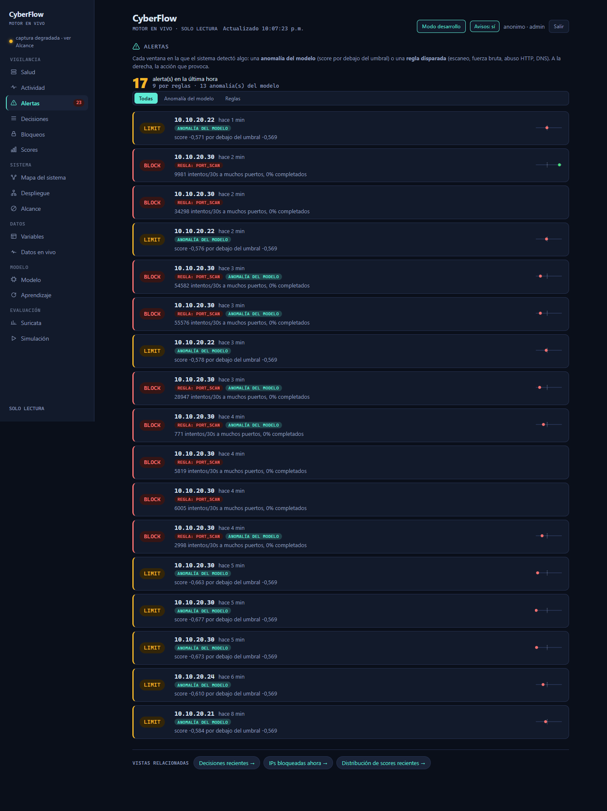
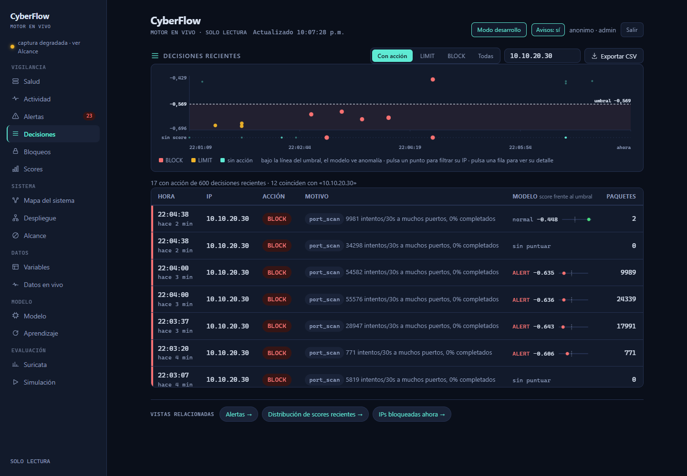
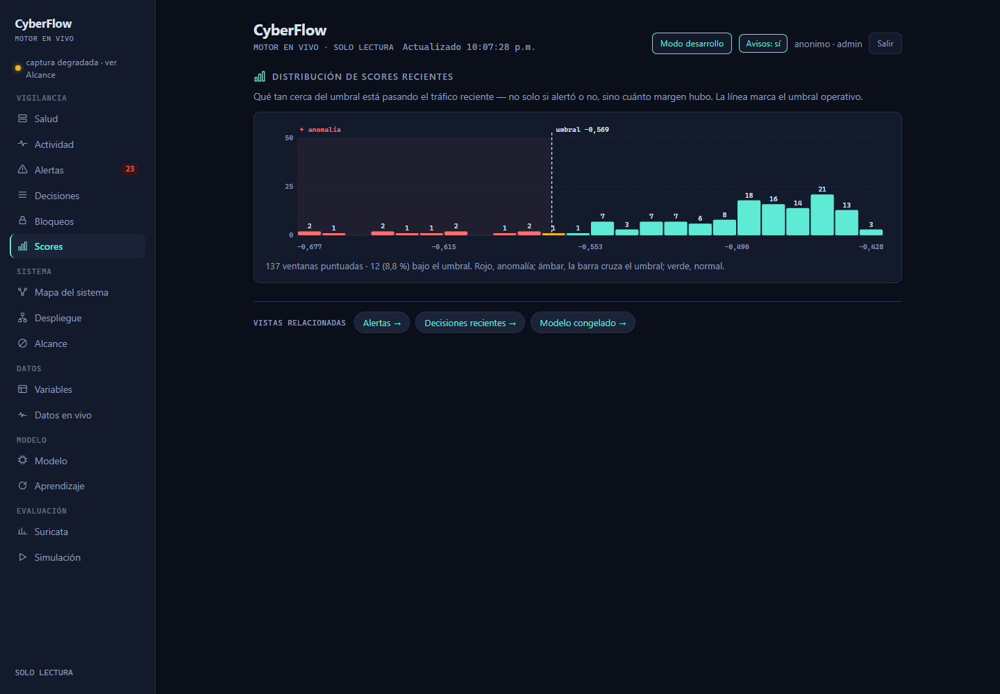
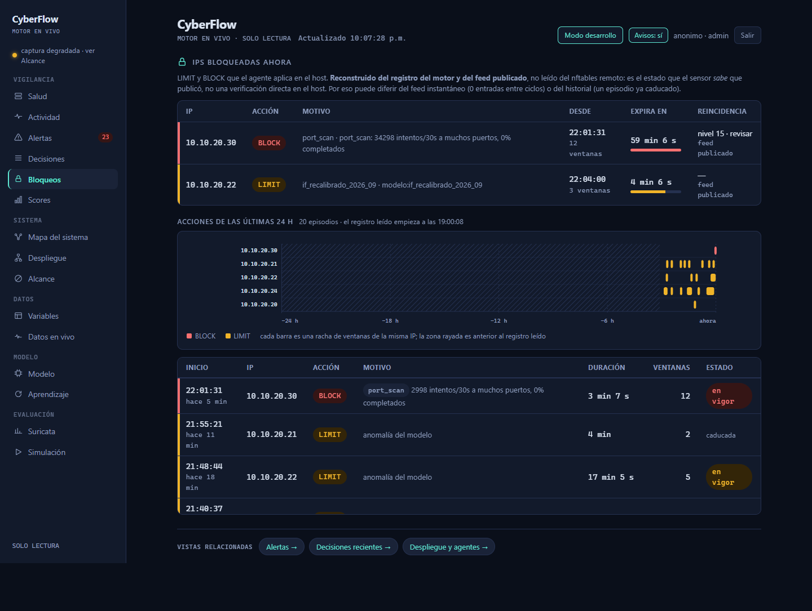
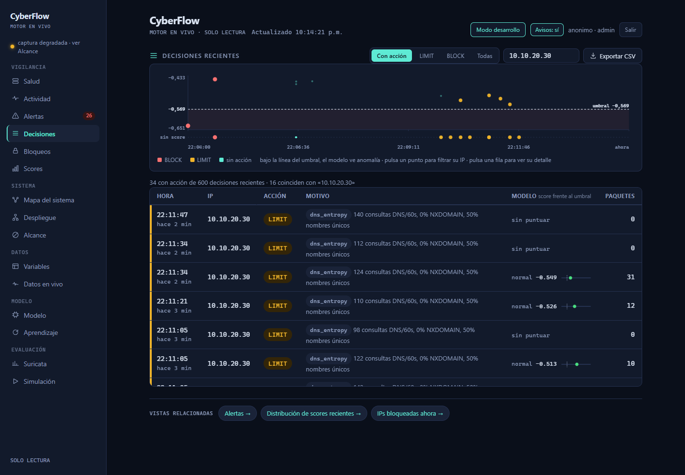
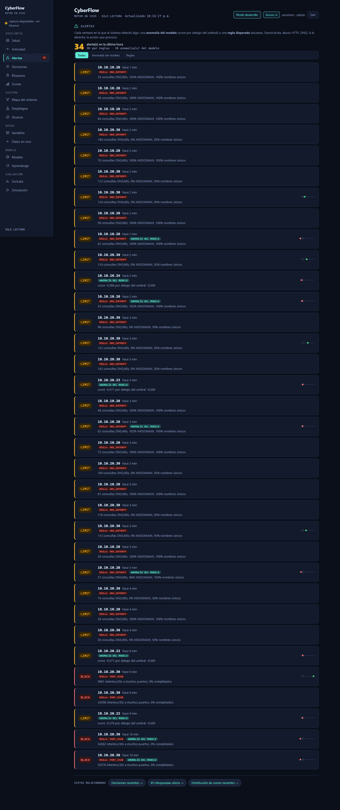
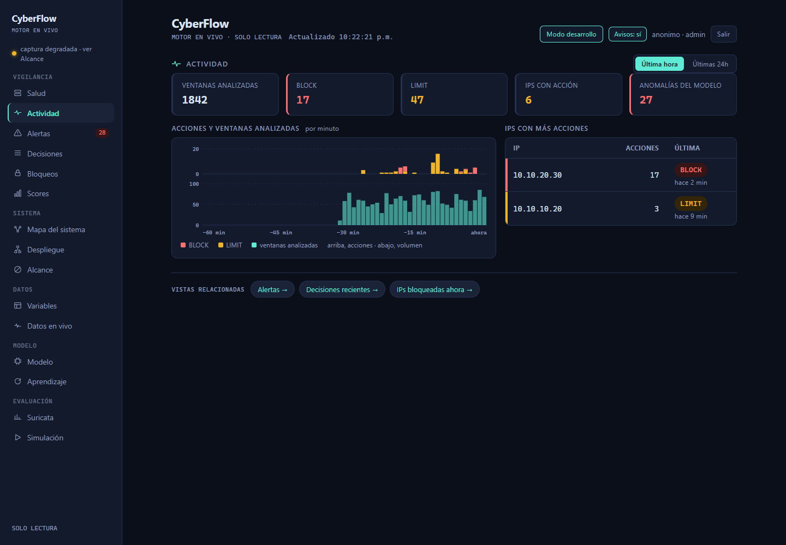
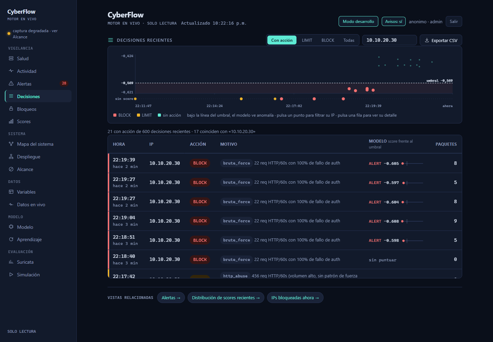
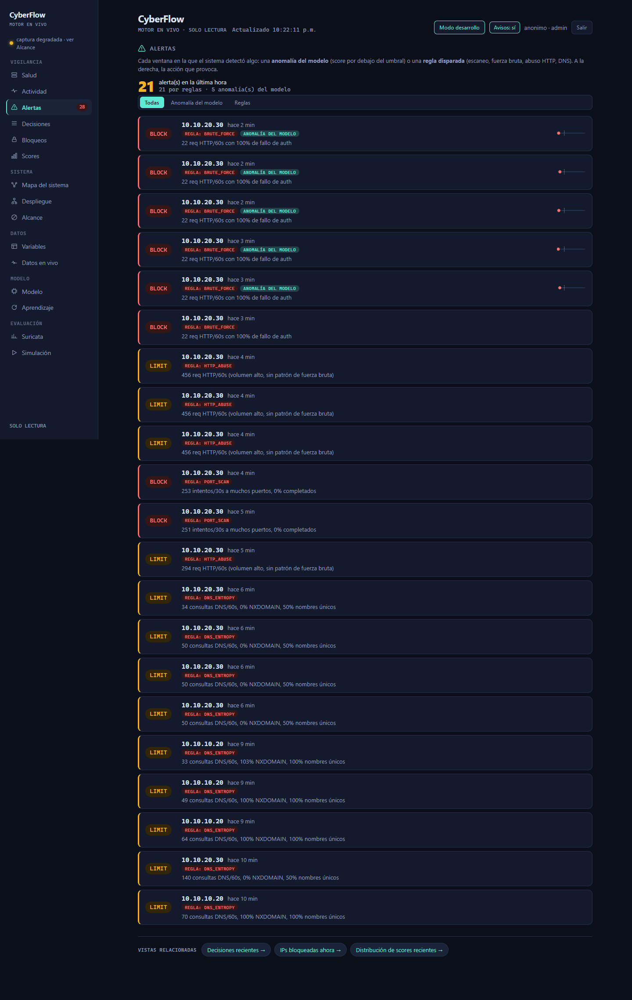
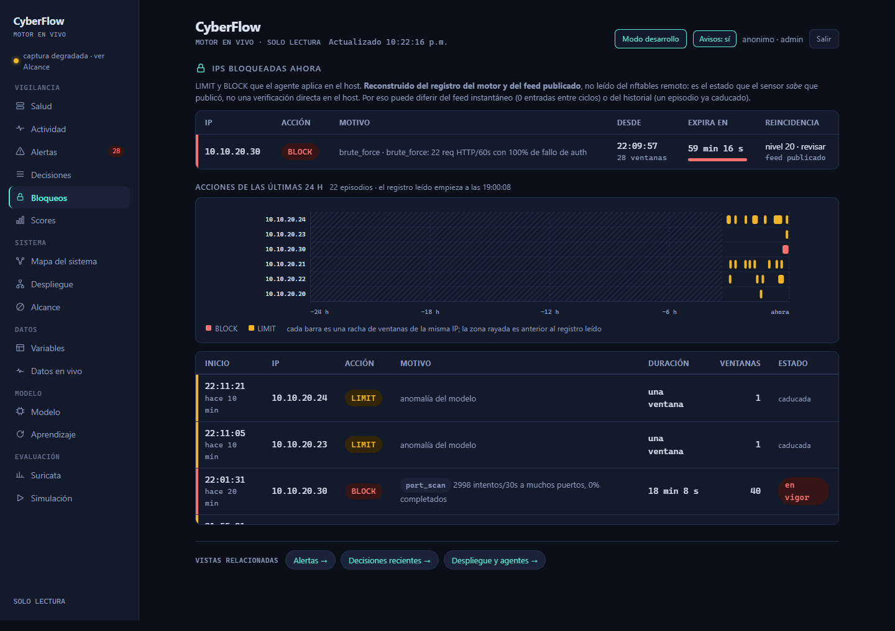

# Recorrido multi-ataque: cuatro familias → detección → respuesta → visualización

**Fecha:** 14-oct-2026 (noche, hora de Perú) · **Ventana de ataque:** 22:01–22:22 PET = 03:01–03:22 UTC (15-oct)
**Ataque desde:** Kali `10.10.20.30` · **Objetivos:** srv-dmz `10.10.30.10` (TCP/HTTP) y resolutor `10.10.10.20` (DNS)
**Detecta/decide:** Sensor `10.10.60.11` · **Aplica la respuesta:** agente en srv-dmz (nftables)

Este documento repite el recorrido del [escaneo del 13-oct](../recorrido-ataque-2026-10-13/RECORRIDO-ATAQUE-RESPUESTA.md)
pero sobre **cuatro familias de ataque con varias variantes cada una**, para enseñar
que cada una activa una ruta de detección distinta (heurístico determinista o
modelo) y una respuesta proporcionada (LIMIT reversible o BLOCK). Cada imagen va
acompañada de la línea real del motor que la respalda, de modo que lo ejecutado,
lo decidido y lo visualizado coincidan.

> **Las imágenes son del panel en vivo** (copia de solo lectura del sensor), en
> modo desarrollador. El reloj del panel está en hora de Perú (22:xx); los
> comandos y el registro del motor van en UTC (03:xx). Diferencia = 5 h.

---

## 0. Componentes activos y nota de red

| Componente | Host | Estado |
|---|---|---|
| Sensor · motor / captura / Suricata / panel | cyberflow-sensor 10.10.60.11 | activos |
| Relay del feed | VM-GESTION 10.10.10.30 | `ppi-relay-feed.timer` activo |
| Agente + cortafuegos | srv-dmz 10.10.30.10 | `ppi-enforce-agent.timer` activo |
| Atacante | Kali 10.10.20.30 | encendida, arsenal completo (nmap, dig, hping3, masscan…) |

> **Cambio de red respecto al 13-oct (importante):** esta noche el puerto **80/tcp
> estaba `open` de extremo a extremo** desde la Kali hacia srv-dmz (el 13-oct estaba
> `filtered`). Eso permitió validar por primera vez los ataques **HTTP reales**
> (flood y fuerza bruta), que antes no llegaban. El puerto 8081 estaba `closed`
> (es decir, **permitido** por el cortafuegos pero sin servicio): se levantó en él
> el endpoint de demostración de fuerza bruta. El cortafuegos sigue siendo de
> **solo lectura** para CyberFlow: la respuesta la aplica el agente en el host.

### Las cuatro reglas deterministas en juego

El modelo (IsolationForest recalibrado, `if_recalibrado_2026_09`, umbral −0,568892)
puntúa cada ventana; en paralelo, cuatro heurísticos cubren patrones donde el
modelo mide flojo (`scripts/engine/heuristicos.py`, versión de umbrales `2026-10-06.2`):

| Heurístico | Dispara con | Acción |
|---|---|---|
| `port_scan` | ≥20 intentos/30s a muchos puertos (únicos ≥0,45) con ≤30% completados · **Ó** ráfaga ≥200/30s con ≤10% completados | **BLOCK** |
| `brute_force` | ≥5 req HTTP/60s con ≥80% de fallo de auth (401/403) | **BLOCK** |
| `http_abuse` | ≥100 req HTTP/60s sin patrón de fuerza bruta | LIMIT |
| `dns_entropy` | ≥20 consultas DNS/60s con ≥50% NXDOMAIN **Ó** ≥45% nombres únicos | LIMIT |

La acción final por IP es la **más severa** entre modelo y heurísticos. Los umbrales
heurísticos son criterio razonado y versionado, **no** calibrados como el del modelo;
así se declara.

---

## 1. Familia 1 — Escaneo de puertos → `port_scan` → **BLOCK**

Tres variantes, la primera de **contraste** (no debe disparar):

| Var. | Comando en la Kali | UTC | Resultado esperado |
|---|---|---|---|
| 1C | `nmap -sV -Pn -p80,443 10.10.30.10` | 03:01:26–03:02:22 | **No** dispara `port_scan` (solo 2 puertos ≪ 20) |
| 1A | `nmap -sT -T4 --max-retries 1 -p 1-3000 --open 10.10.30.10` | 03:02:50–03:03:13 | `port_scan` **rama normal** → BLOCK |
| 1B | `nmap -sT -T5 --min-rate 1500 --max-retries 0 -p- --open 10.10.30.10` | 03:03:25–03:04:09 | `port_scan` **rama ráfaga** (≥200/30s) → BLOCK |

**Detección (motor).** Línea real (`logs/motor_decision.log`):

```json
{"decision": "ALERT", "detector_name": "if_recalibrado_2026_09", "entity_ip": "10.10.20.30",
 "heuristico": {"accion": "BLOCK", "heuristico": "port_scan",
                "motivo": "34298 intentos/30s a muchos puertos, 0% completados"}}
```

El escaneo de rango completo (1B) generó ventanas de **hasta 55 576 intentos/30s con
0% completados**; la variante de contraste (1C) no aparece como acción (quedó en
PERMIT). Doble señal: regla determinista **y**, en las ventanas más densas, anomalía
del modelo.


*Alertas. Varias tarjetas `10.10.20.30 · BLOCK · REGLA: PORT_SCAN` con los recuentos
reales de 1A y 1B (9981, 34298, 54582, 55576 intentos/30s, 0% completados). Las
ventanas más densas llevan además **ANOMALÍA DEL MODELO**. Las LIMIT sobre `.21/.22/.24`
son clientes legítimos: el FPR acotado del modelo (nunca llega a BLOCK).*


*Decisiones filtradas por `10.10.20.30`: cada ventana con su acción BLOCK, el motivo
`port_scan` y el score frente al umbral. La variante de contraste 1C no genera filas
con acción, como se esperaba.*


*Distribución de scores recientes: las barras rojas a la izquierda del umbral −0,569
son las ventanas que el modelo ve como anomalía (escaneo + FP de clientes).*

**Respuesta (enforcement).** A los ~2 ciclos de feed, el agente aplicó el bloqueo en
srv-dmz:

```
cyberflow_bloqueados { 10.10.20.30  timeout 58m }     ← limitados quedó vacío
```

Prueba desde la Kali (before/after):

| Momento | `nmap -p80,443 10.10.30.10` |
|---|---|
| Durante el escaneo | `80/tcp open · 443/tcp open` |
| Tras el BLOCK | `80/tcp filtered · 443/tcp filtered` ← la Kali queda cortada |


*Bloqueos: `10.10.20.30 · BLOCK · port_scan` **en vigor** con su motivo, desde cuándo,
caducidad y nivel de reincidencia. La vista declara que su estado es **reconstruido
del registro y del feed**, no leído del nftables remoto.*

---

## 2. Familia 2 — DGA / DNS de alta entropía → `dns_entropy` → **LIMIT**

El hueco donde el modelo saca ~0% (nota M): se cubre con un heurístico sobre la
ventana DNS. El DNS va al resolutor `10.10.10.20`, **otro destino** que el bloqueo de
srv-dmz, así que esta familia opera aunque la Kali esté contenida en la DMZ.

| Var. | Comando en la Kali (bucle) | UTC |
|---|---|---|
| 2A | 80× `dig +short <aleatorio>.francos-sac.com @10.10.10.20` | 03:10:09–03:11:01 |
| 2B | 70× `dig +short <aleatorio>.<aleatorio>.com @10.10.10.20` | 03:11:21–03:12:06 |

**Detección (motor).** El heurístico disparó con motivos reales *"140 / 124 / 112 / 110 /
98 consultas DNS/60s…"* → **LIMIT**. Lo revelador es la columna del modelo:

```json
{"decision": "PERMIT", "detector_name": "if_recalibrado_2026_09", "entity_ip": "10.10.20.30",
 "heuristico": {"accion": "LIMIT", "heuristico": "dns_entropy",
                "motivo": "124 consultas DNS/60s, 0% NXDOMAIN, 50% nombres únicos"}}
```

**El modelo las ve normales** (`decision: PERMIT`, score por encima del umbral) y el
**heurístico las caza igual**. Es exactamente la razón de ser de los heurísticos.


*Decisiones filtradas por `10.10.20.30`: filas `LIMIT · dns_entropy` con los recuentos
de consultas, y la columna MODELO en **"normal −0,549 / −0,526 / −0,513"** o "sin
puntuar". El modelo no se inmuta; el heurístico sí.*


*Alertas: el heurístico marca al atacante `.30` (50% nombres únicos — el espejo SPAN
topa el ratio en ~0,5) y también al **resolutor `10.10.10.20`**, que absorbe la ráfaga
de nombres aleatorios (100% únicos). Respuesta = LIMIT (degradar), no cortar: un DGA
puede confundirse con uso legítimo intenso.*

> **Nota honesta (pendiente de corregir):** el NXDOMAIN de las variantes salió **0%**
> para el atacante (el resolutor no devolvió NXDOMAIN; disparó por la rama de *nombres
> únicos*). Y en algunas tarjetas del resolutor el panel muestra **"103% NXDOMAIN"**
> —ratio por encima de 100%, un artefacto de conteo con el espejo que **conviene
> acotar a 100%** en la presentación. No afecta a la decisión, pero es visualmente
> incoherente.

---

## 3. Familia 3 — Flood / abuso HTTP → `http_abuse` → **LIMIT**

| Var. | Comando en la Kali | UTC |
|---|---|---|
| 3A | `seq 1 250 | xargs -P10 -I{} curl -s -o /dev/null http://10.10.30.10/` | 03:16:47–03:16:49 |

**Detección (motor).** Volumen alto **sin** fallo de autenticación → se clasifica como
abuso, no como fuerza bruta:

```json
{"heuristico": {"accion": "LIMIT", "heuristico": "http_abuse",
                "motivo": "456 req HTTP/60s (volumen alto, sin patrón de fuerza bruta)"}}
```

La respuesta es **LIMIT** (degradar la tasa, reversible) porque un pico de peticiones
puede ser uso pesado legítimo: el sistema no corta por volumen a secas.


*Actividad: el pico de acciones y volumen de ventanas sobre la línea de tiempo durante
la batería de ataques.*

---

## 4. Familia 4 — Fuerza bruta HTTP → `brute_force` → **BLOCK**

Requiere ver el `status` 401 en claro (por eso HTTP, no TLS). Montaje: endpoint de
laboratorio `endpoint_401.py` en srv-dmz:8081 (responde 401 a todo; sin credenciales
reales). Antes de esta familia se **restauró el alcance** de la Kali (reset de operador:
se quitó el elemento `.30` del set, documentado), para poder atacar el 8081.

| Var. | Comando en la Kali | UTC |
|---|---|---|
| 3B | 50× `curl -u admin:wrong$i http://10.10.30.10:8081/` | 03:18:55–03:21:52 |

**Detección (motor).** ≥5 req/60s con 100% de fallo de auth → señal inequívoca → BLOCK:

```json
{"decision": "ALERT", "detector_name": "if_recalibrado_2026_09", "entity_ip": "10.10.20.30",
 "heuristico": {"accion": "BLOCK", "heuristico": "brute_force",
                "motivo": "22 req HTTP/60s con 100% de fallo de auth"}}
```

Aquí el **modelo también** marca anomalía (`ALERT`, score −0,605): el patrón de fuerza
bruta sí movió las variables L4 lo suficiente.


*Decisiones por `10.10.20.30`: filas `BLOCK · brute_force` (*"22 req HTTP/60s con 100%
de fallo de auth"*, modelo ALERT −0,605) y, abajo, la fila `http_abuse` del flood
(*"456 req HTTP/60s…"* → LIMIT). Las dos sub-familias HTTP con motivos distintos.*


*Alertas con las tarjetas de fuerza bruta (BLOCK) y abuso HTTP (LIMIT) sobre el mismo
atacante.*

**Respuesta (enforcement) — visible dentro del propio ataque.** De los **50 intentos,
solo 11 llegaron (401)** y **39 expiraron (timeout)**: las primeras peticiones bastaron
para disparar `brute_force` → BLOCK, y el resto **se cortó** al aplicarse el bloqueo.

| Momento | `curl http://10.10.30.10:8081/` |
|---|---|
| Inicio de 3B | `401` (llega al endpoint) |
| Tras el BLOCK | `000` / timeout 6 s ← cortada |


*Bloqueos: `10.10.20.30 · BLOCK · brute_force` en vigor con su motivo real. (El episodio
`port_scan` previo sigue listado por la reconstrucción del registro, como declara la
vista.)*

---

## 5. Validación: lo ejecutado ↔ lo decidido ↔ lo visualizado

| Familia (Kali) | Motor (heurístico / modelo) | Acción | Dónde se ve |
|---|---|---|---|
| Escaneo `nmap` 1A/1B | `port_scan` (hasta 55 576/30s, 0% compl.) + modelo ALERT | **BLOCK** | Alertas, Decisiones, Scores, Bloqueos |
| Escaneo de versión 1C (contraste) | ninguno (2 puertos) | PERMIT | — (no genera acción) |
| DGA `dig` 2A/2B | `dns_entropy` (modelo PERMIT) | LIMIT | Alertas, Decisiones |
| Flood `curl` 3A | `http_abuse` (456 req/60s) | LIMIT | Decisiones, Actividad |
| Fuerza bruta `curl -u` 3B | `brute_force` (100% fallo auth) + modelo ALERT | **BLOCK** | Alertas, Decisiones, Bloqueos |

Criterio: **IP, hora, motivo y score del panel coinciden con la línea del
`motor_decision.log`**, y el elemento del set nftables en srv-dmz coincide con la
caducidad que muestra Bloqueos.

**Lectura de conjunto.** Las dos señales de alta confianza (escaneo, fuerza bruta)
**cortan**; las ambiguas (volumen HTTP, entropía DNS) **degradan**. El modelo caza lo
que se desvía de lo normal (escaneo, fuerza bruta); los heurísticos cubren lo que el
modelo no ve (DGA). Juntos dan cobertura con respuesta proporcionada.

---

## 6. Protección de la línea base

Antes de atacar se añadió la ventana `10.10.20.30@2026-10-15T02:55:00+00:00/…T05:30:00+00:00`
a `excluir_ventanas` del `cyberflow.local.toml` (copia de seguridad + validación con
`tomllib`), para que **el tráfico de ataque no entre al reentrenamiento**. La ventana
cubre toda la batería (03:01–03:22 UTC).

---

## 7. ARP spoofing — por qué NO se ejecutó esta noche

La quinta familia prevista era **ARP spoofing** (la puerta de enlace vista con dos MAC
→ mueve `unique_src_mac_30s`), que es la que caza el **modelo** y no un heurístico —un
buen contraste con Suricata, que no la ve sin firma—. Se **pospone a una ventana
dedicada**: inyectar una anomalía de capa 2 sobre la puerta de enlace mientras el
**reentrenamiento está vivo** y hay tráfico legítimo de clientes podría afectar tanto a
la línea base como a los propios clientes. Es la decisión responsable; queda como
siguiente paso.

---

## 8. Observaciones y correcciones aplicadas

Las tres incoherencias que destapó este recorrido ya están **corregidas y
desplegadas** (producto-main `ad47745`, as-deployed `2d854a9`):

- **Red (resuelto):** la nota de Topología/Alcance ya refleja que el puerto 80 está
  abierto E2E y que los ataques HTTP (flood→LIMIT, fuerza bruta→BLOCK) se validaron de
  extremo a extremo; se eliminó la afirmación antigua de que no llegaban.
- **Display `>100% NXDOMAIN` (resuelto):** el ratio se acota a 1.0 en el extractor v2
  (la raíz, lo que ve el modelo) y en el motivo del heurístico `dns_entropy` (la
  presentación). Se reinició `ppi-motor`; las nuevas decisiones DNS ya muestran ≤100%.
- **Reincidencia de la Kali (resuelto):** se reseteó el contador (estaba en **20**) en
  el estado de la escalera del sensor y se limpió su bloqueo; la Kali vuelve a estar
  alcanzable y una próxima ofensa arrancaría en el primer nivel (300 s).
- **Alertas ya cuadra con Actividad:** el titular de Alertas toma el recuento de la
  hora de los contadores del servidor (arreglo previo de esta sesión).
- **Estado final de la Kali:** **sin bloqueo y alcanzable** (pizarra limpia para una
  demo); la línea base sigue protegida por `excluir_ventanas`.
</content>
